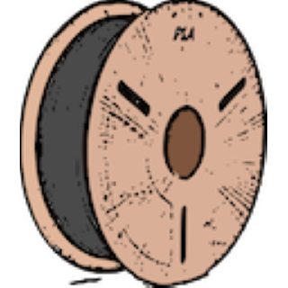

# 3D Filament Profiles plugin for OrcaSlicer 2.5

Connects OrcaSlicer to [3dfilamentprofiles.com](https://3dfilamentprofiles.com) via its API
([docs](https://3dfilamentprofiles.com/docs/api)). It's a single file, `threedfp_profiles.py`, with no dependencies beyond Python's standard library.

> Unofficial community plugin, not affiliated with 3D Filament Profiles or OrcaSlicer. Review generated filament
> settings before printing: they come from community data.

**Requirements**
- OrcaSlicer **2.5 or newer**, which has the Python plugin system.
- A 3DFP API key: the API subscription, or a Patreon tier that includes it.

It was developed and tested on Windows with a Bambu Lab H2C. The printer detection also covers the X1/P1/P2S/A1/A2L/H2/X2D
families, and other printers get 3DFP's printer-neutral ("ANY") profile.

## What it does

A **3DFP** panel docks on the right of the Prepare/Preview tabs:

| Tab | |
|---|---|
| **Find** | Search the 3DFP catalog (brand, material, colour, hex). Click a filament for temps, density, flow ratio, max volumetric speed, price. |
| **My spools** | Your 3DFP spools with grams left and location. |
| **Slots** | Link each filament slot to a spool; shows the grams per slot from the last slice; **Deduct from 3DFP spools**. |
| **Settings** | API key, printer/nozzle override (auto-detected from the printer preset, e.g. H2C / P2S, 0.4), pressure advance, options below. |

**Use in slot N** (for a catalog filament or one of your spools):
1. Asks 3DFP for its OrcaSlicer preset for your printer + nozzle (for a spool, your calibrated temps/flow/K are used).
2. Selects the matching system preset in that slot (e.g. `Bambu PLA Basic @BBL H2C`, or a Generic preset of the
   same type if that one isn't enabled) and applies the 3DFP values on top. It shows as an unsaved edit, and you can save it from the filament settings.
3. Also writes it as a user preset (`%APPDATA%\OrcaSlicer\user\<id>\filament\<name>.json`), which shows up in the filament list
   **after OrcaSlicer restarts**. If a file with that name already exists, the old one is backed up to the plugin's data folder first.
   If you're signed in to Orca Cloud, OrcaSlicer uploads a new preset at that restart. An updated preset is marked in its `.info`
   file so the change is uploaded too, rather than replaced by the older cloud copy.

**Save preset** only does step 3.

**Spool deduction:** after slicing, the grams per slot are read from the G-code. When a print is sent, the plugin
subtracts them from the slots' spools and shows the result as a notification. This is on by default. If you turn off **Deduct
without asking** in Settings, you get a notification with a **Deduct** link instead, or you can use the **Deduct from 3DFP spools**
button in Slots. The deduction itself is one API request.

Which spool a slot uses:
1. The spool you picked for it in **Slots** (or set with **Use in slot** on a spool), if any.
2. Otherwise (**Link slots to spools automatically**, on by default), the spool your 3DFP spool list places in the
   selected printer's AMS. It must have the same filament type, and the closest colour wins. On a tie, the first AMS
   position wins, and the other spool is shown as an alternative. The plugin re-reads your spools when the print starts
   (one more request), so the 3DFP locations need to be current. A tool that syncs AMS slots to 3DFP locations keeps
   them current, or you can set them on 3DFP by hand. 3DFP locations look like `Printer: H2C, AMS: A-1`, `Printer: H2C, AMS: HT-A-1` or
   `Printer: P2S, External Spool`. The printer name (`H2C`) must appear in the OrcaSlicer printer preset name.
3. A slot that used filament but gets no spool isn't deducted, and a warning notification says which slot and why.

The plugin can't see the AMS mapping you confirm in the send dialog: the OrcaSlicer plugin API doesn't expose it. If you
remap a slot to a different tray there, pick that spool in **Slots** before sending.

Slices, print starts, the links chosen and each deduction are logged to `events.log` in the plugin's data folder.

## Install

1. OrcaSlicer → main menu → **Plugins** → the arrow on **Browse plugins** → **Install local plugin** → pick `threedfp_profiles.py`.
2. Approve the permission prompt: HTTPS to `3dfilamentprofiles.com`, worker threads, and read access to Orca's temp slice folder.
3. Select the plugin and press **Run** to open the panel. After that it opens by itself when a project opens; you can turn that off in Settings.
4. **Settings** → paste your API key (`3dfp_…`, from the *API access* page in the 3DFP user menu; it needs the API subscription or a Patreon tier).

To update the plugin, copy the new file over the installed copy at
`%APPDATA%\OrcaSlicer\orca_plugins\threedfp_profiles.py\threedfp_profiles.py` and restart OrcaSlicer. That keeps the approved
permissions. Using **Install local plugin** again also works, but it resets the permissions and you'll be asked to approve them again.

The panel shares the right-hand dock with other plugin panels (SlicePilot, MakerWorld). Drag its edge to make it taller.

## API quota

Searches only run when you press Search or Enter, filament details are cached for the session, and the spool list is fetched only when you press
Refresh. A deduction for all slots is one request. The footer shows the remaining monthly quota (`API 982/1000`).

## Orca Cloud upload files

Orca Cloud requires a target suffix right before `.py`/`.whl`. It accepts exactly these: `any`, `win_x86_64`, `win_arm64`, `win`,
`macosx_arm64`, `macosx_x86_64`, `macosx_universal`, `macosx`, `linux_x86_64`, `linux_arm64`, `linux`. The plugin is pure
Python, so one `_any` file covers every OS:

```powershell
python tools/make_upload_files.py              # dist/threedfp_profiles_any.py  <- upload this
python tools/make_upload_files.py win_x86_64   # per-OS copies instead, if ever needed (identical content)
```

**Icon:** upload `assets/icon.png`, a square 320×320 PNG with a transparent background. OrcaSlicer shows a plugin's picture
from its Orca Cloud listing, and a plugin can't set it from its own file. The panel header uses an embedded copy, `assets/icon_64.png`.
After changing the logo, run `python tools/embed_logo.py` to refresh that copy.

## Tests

```powershell
python tests/test_offline.py          # any Python 3.12+, no OrcaSlicer or API key needed
```

The test script checks printer detection, setting serialization, preset file writing (including the Orca Cloud `.info`), base-preset choice and G-code
parsing. It also loads the plugin against a stub `orca` module.

## Command-line API check (no OrcaSlicer needed)

```powershell
& "C:\Program Files\OrcaSlicer\python\python.exe" -I threedfp_profiles.py 3dfp_YOURKEY search sunlu pla matte
& "C:\Program Files\OrcaSlicer\python\python.exe" -I threedfp_profiles.py 3dfp_YOURKEY profile 101 H2C 0.4
& "C:\Program Files\OrcaSlicer\python\python.exe" -I threedfp_profiles.py 3dfp_YOURKEY spools
```

## Notes / limits

- The OrcaSlicer plugin API can edit a slot's preset but can't create a new preset in a running session. That's why the saved preset file only appears after a restart, while the slot edit works right away.
- Orca Cloud sync keeps a preset's cloud ID in the `.info` file next to its `.json`, and OrcaSlicer writes that file itself.
  On each sync, OrcaSlicer deletes a local preset that has a cloud ID the cloud doesn't list. So never make up a `setting_id`:
  leave it empty and OrcaSlicer uploads the preset as new. The plugin never writes one. It clears the ID in a `.info` left over
  from a removed preset, and on an update it sets `sync_info = update` and a newer `updated_time`.
- The API key is stored in plain text in `%APPDATA%\OrcaSlicer\orca_plugins\plugin_data\<plugin key>\settings.json`.
